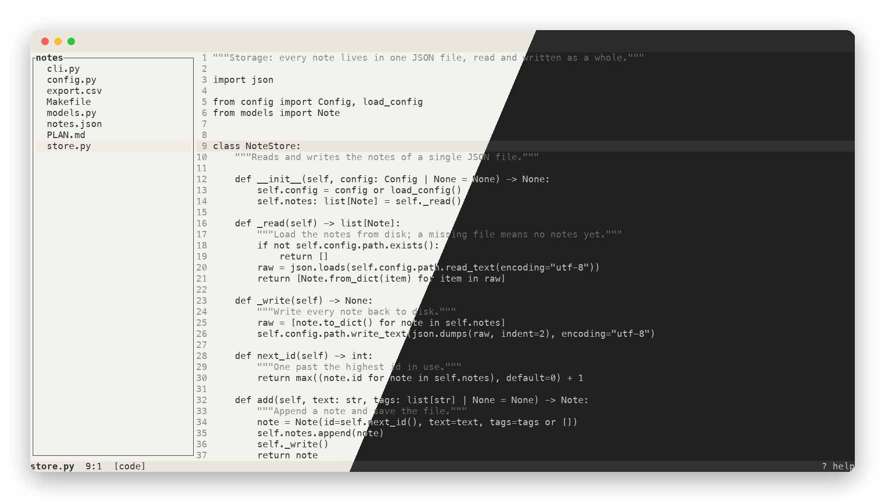
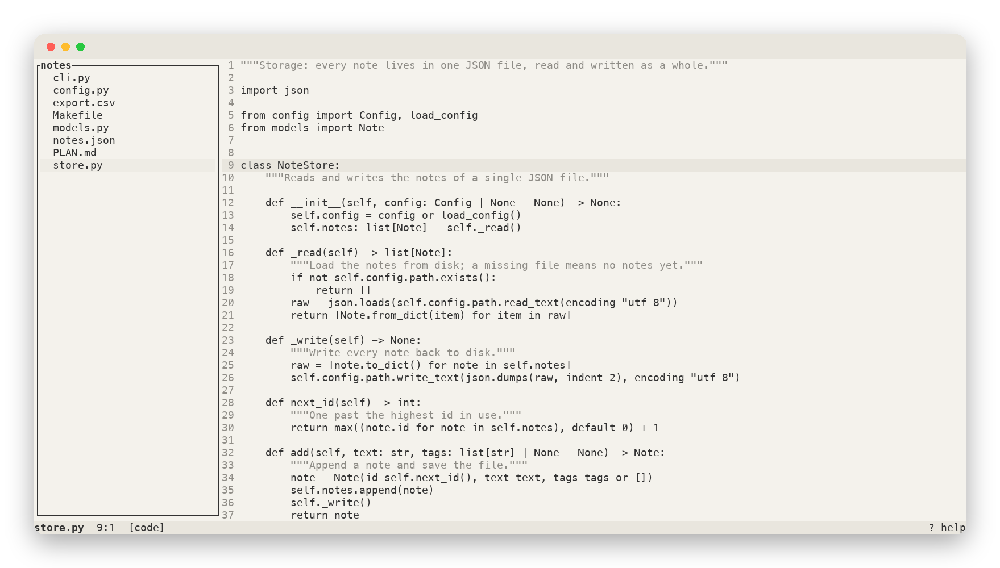
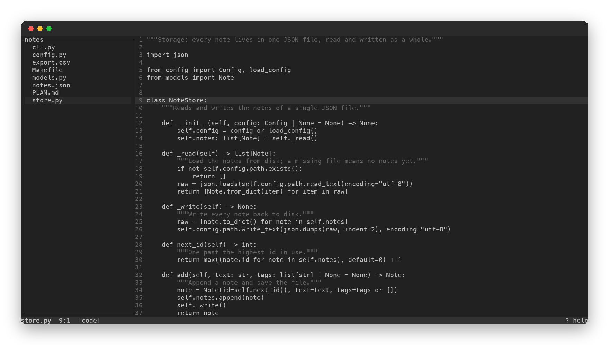
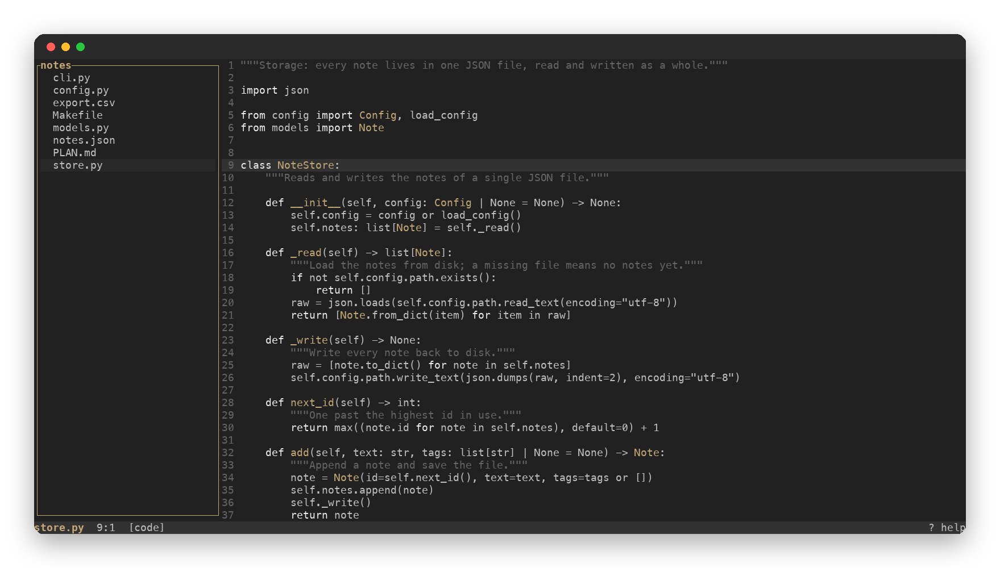
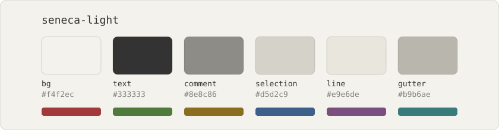
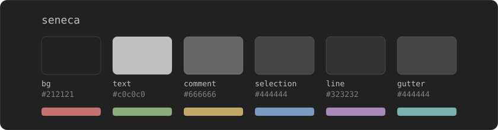
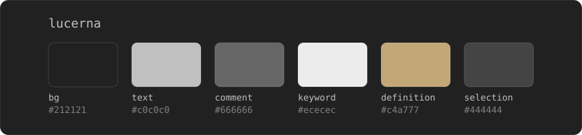

<p align="center"></p>

# seneca

Quiet themes for reading code: text in one grey, comments in a darker one, nothing else coloured.
Three of them:

- `seneca-light`: grey on paper.
- `seneca`: grey on #212121.
- `lucerna`: `seneca` with brighter keywords and definition names in bronze, for when you want a
  little structure back. There's no light version: bronze fades on paper.

<table>
<tr>
<td align="center"><br><code>seneca-light</code></td>
<td align="center"><br><code>seneca</code></td>
</tr>
<tr>
<td align="center" colspan="2"><br><code>lucerna</code></td>
</tr>
</table>

## Files

| App | File |
|---|---|
| [merl](https://github.com/Maksim-Burtsev/merl), bat, Sublime Text, anything that reads TextMate themes | `tmtheme/*.tmTheme` |
| Ghostty, [agterm](https://github.com/umputun/agterm) | `ghostty/seneca`, `ghostty/seneca-light` |

A terminal has no syntax to colour, so `lucerna` in a terminal is just `seneca`.

## Install

**merl.** All three are built in: `merl --theme seneca-light`, or `theme = "seneca-light"` in
`~/.config/merl/config.toml`.

**bat.**

```sh
mkdir -p "$(bat --config-dir)/themes"
cp tmtheme/*.tmTheme "$(bat --config-dir)/themes/"
bat cache --build
bat --theme seneca-light file.py   # or BAT_THEME=seneca-light
```

**Sublime Text.** Copy a `.tmTheme` into `Packages/User/` and pick it under
*UI → Select Color Scheme*.

**Ghostty.** Copy the files into `~/.config/ghostty/themes/` and set `theme = seneca-light`, or
point at the file directly: `theme = /path/to/ghostty/seneca-light`. A pair that follows the
system appearance: `theme = light:seneca-light,dark:seneca`.

**agterm.** It reads Ghostty config. Keep agterm's own theme on the default
(`agtermctl theme set`), or it overrides yours, then set the theme in its Ghostty config as above.
agterm takes selection colours only from its bundled themes, so with a theme loaded by path the
selected sidebar row goes white on white. Repeat the selection colours next to the `theme` line:

```
selection-background = #d5d2c9
selection-foreground = #000000
```

For `seneca`, use `#444444` and `#ffffff`.

**Claude Code.** It draws in your terminal, so set the terminal to seneca first, then pick the
ANSI-only theme in `/theme` (light or dark): Claude Code then paints with seneca's muted ANSI
colours instead of its own. No file needed.

**Claude desktop.** Light, dark or system only; it has no custom themes yet.

## Palette

Everything you need to port the themes to a new app.





The strip under each card is the terminal's red, green, yellow, blue, magenta and cyan.

### Editor

| Role | seneca-light | seneca | lucerna |
|---|---|---|---|
| Background |  `#f4f2ec` |  `#212121` |  `#212121` |
| Text |  `#333333` |  `#c0c0c0` |  `#c0c0c0` |
| Comment |  `#8e8c86` |  `#666666` |  `#666666` |
| Keyword | text | text |  `#ececec` |
| Function, class, type name | text | text |  `#c4a777` |
| Operator | text | text | text |
| Cursor |  `#333333` |  `#c0c0c0` |  `#c0c0c0` |
| Selection |  `#d5d2c9` |  `#444444` |  `#444444` |
| Current line |  `#e9e6de` |  `#323232` |  `#323232` |
| Search match (background / text) |  `#c9c5ba` /  `#000000` |  `#5a5a5a` /  `#ffffff` |  `#5a5a5a` /  `#ffffff` |
| Line numbers |  `#b9b6ae` |  `#444444` |  `#444444` |

Headings and bold are bold, italics are italic. Strings, numbers and everything else stay text.

### Terminal (ANSI)

| # | Colour | seneca-light | seneca |
|---|---|---|---|
| 0 | black |  `#333333` |  `#323232` |
| 1 | red |  `#a33a3a` |  `#c27070` |
| 2 | green |  `#4f7a3a` |  `#8aab7a` |
| 3 | yellow |  `#8a6d1f` |  `#c2a86a` |
| 4 | blue |  `#3d5f8a` |  `#7a9ac2` |
| 5 | magenta |  `#7a4f80` |  `#a888b8` |
| 6 | cyan |  `#3a7a7a` |  `#7ab0b0` |
| 7 | white |  `#e9e6de` |  `#c0c0c0` |
| 8 | bright black |  `#8e8c86` |  `#666666` |
| 9 | bright red |  `#b84a4a` |  `#d08080` |
| 10 | bright green |  `#5e8a48` |  `#9abb8a` |
| 11 | bright yellow |  `#9a7b2a` |  `#d0b87a` |
| 12 | bright blue |  `#4c6f9a` |  `#8aaad0` |
| 13 | bright magenta |  `#8a5f90` |  `#b898c8` |
| 14 | bright cyan |  `#4a8a8a` |  `#8ac0c0` |
| 15 | bright white |  `#ffffff` |  `#ffffff` |

The ANSI colours are muted on purpose, so git diffs, `ls` and errors still read apart without
shouting.

## Credits

The greys follow [huyvohcmc/atlas.vim](https://github.com/huyvohcmc/atlas.vim), a fork of
[jacoborus/tender.vim](https://github.com/jacoborus/tender.vim) (MIT). The themes started in
[merl](https://github.com/Maksim-Burtsev/merl).

MIT licence.
